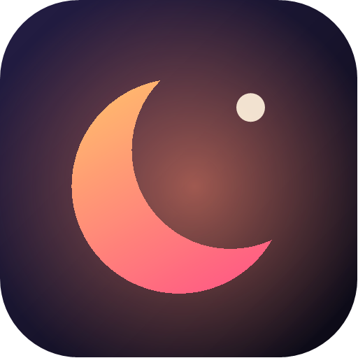
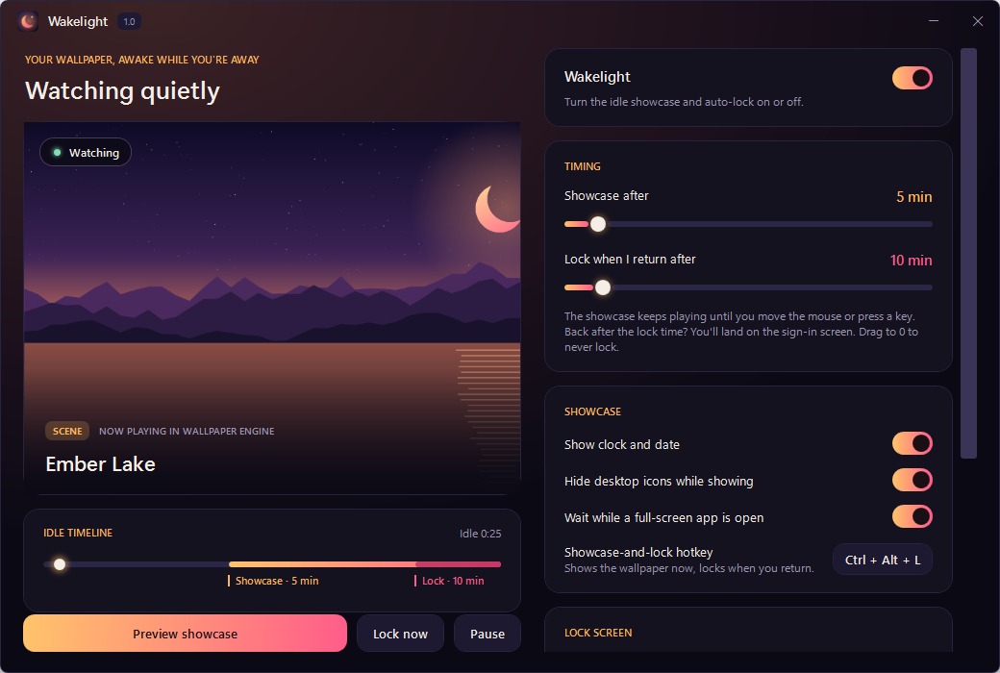
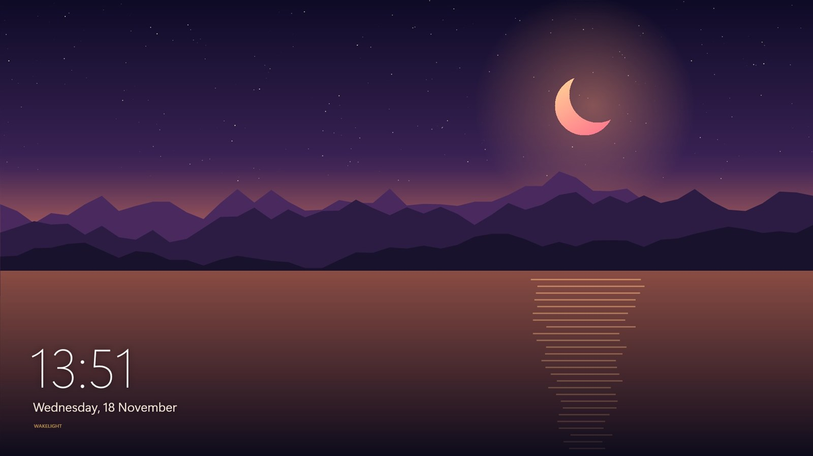
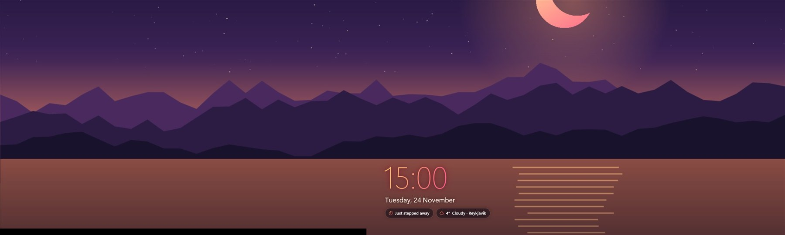
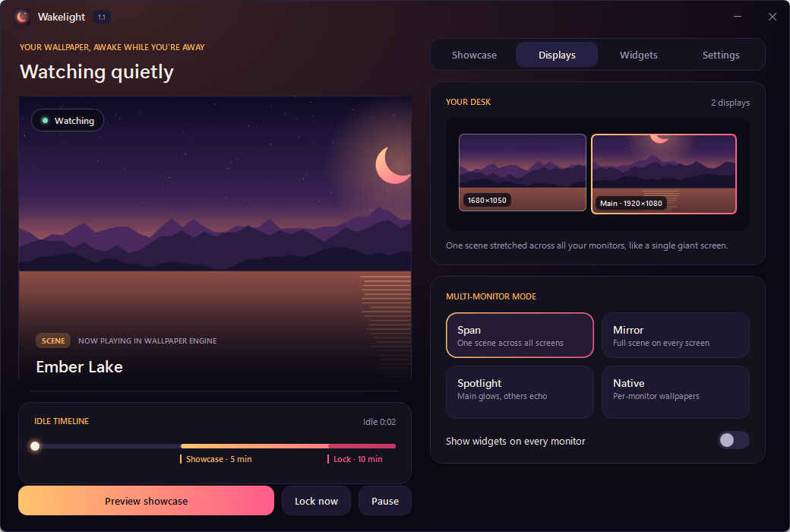
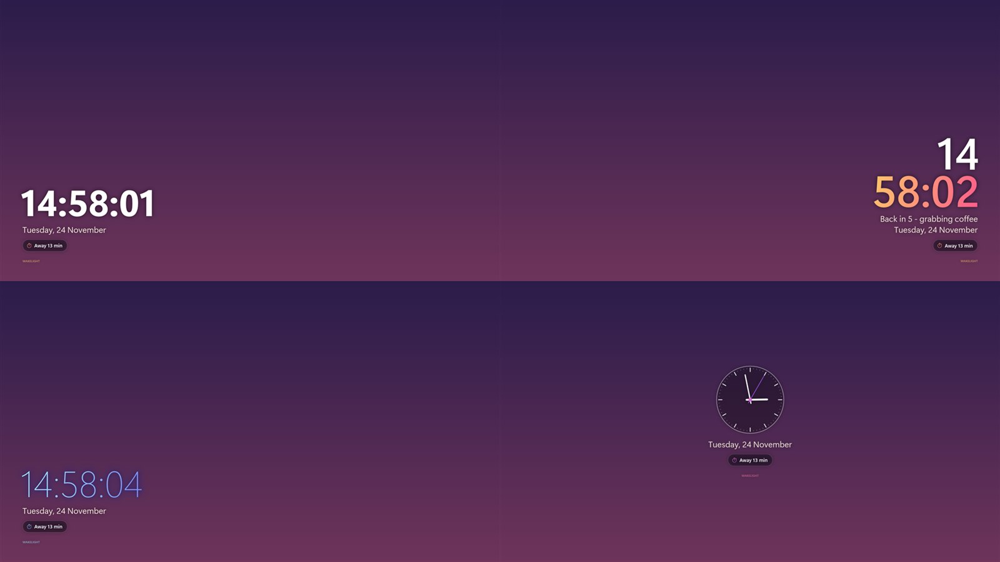
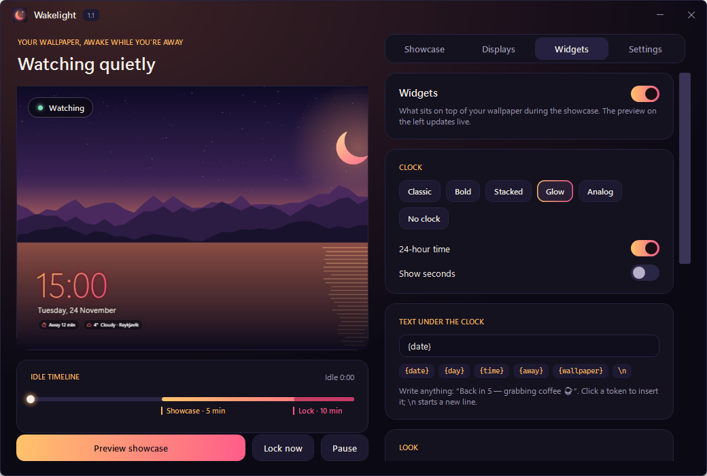
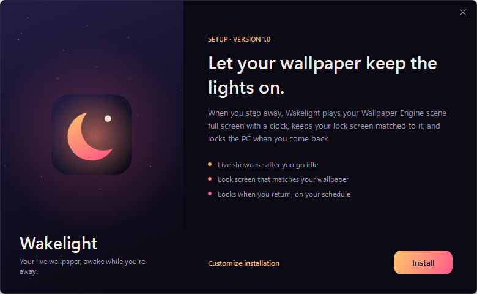

<p align="center">
  
</p>

<h1 align="center">Wakelight</h1>
<p align="center"><b>Your live wallpaper, awake while you're away.</b></p>

Wakelight is a small Windows companion for [Wallpaper Engine](https://www.wallpaperengine.io/).
When you step away from your PC, it plays your live wallpaper full screen with a clock,
keeps the Windows lock screen matched to it, and locks the PC when you come back.

<p align="center">
  
</p>

## The showcase

Step away and your wallpaper takes the whole screen, live, with a quiet clock. Move the mouse and you're back
(or on the sign-in screen, if you were gone longer than your lock time).

<p align="center">
  
</p>

## Every monitor, your way (new in 1.1)

Wallpaper Engine often plays on just one screen. Wakelight fills them all:

| Mode | What you get |
| --- | --- |
| **Span** | One continuous scene across all monitors, like a single giant screen |
| **Mirror** | The full scene on every monitor |
| **Spotlight** | Main monitor in full glow, the others show a dimmed echo |
| **Native** | Each monitor shows whatever Wallpaper Engine draws on it |

<p align="center">
  
  <br><sub>Span across a 1680×1050 + 1920×1080 desk</sub>
</p>

<p align="center">
  
</p>

## Widgets (new in 1.1)

- **Clock styles:** Classic, Bold, Stacked, Glow and an animated Analog face, 12/24 h, optional seconds.
- **Your own text under the clock**, with tokens: `{date}`, `{day}`, `{time}`, `{away}`, `{wallpaper}`, `\n` for a new line. *"Back in 5 — grabbing coffee"*, anyone?
- **Extras:** an "away for" timer, live weather (Open-Meteo, no account; only the city name you type is sent), the wallpaper's name.
- **Look:** five positions, size from 60 % to 160 %, and five accent colors (Ember, Rose, Ice, Mint, Moonlight).
- **Where:** on the main monitor only, or on every monitor.
- The **preview updates live** in the app as you change things.

<p align="center">
  
</p>
<p align="center">
  
</p>

<sub>Screenshots use an original demo scene ("Ember Lake"), not a Workshop wallpaper.</sub>

## Features

- **Idle showcase.** After a few minutes idle, your Wallpaper Engine scene, video or web wallpaper fills every monitor, live, at full frame rate, with an optional clock and date. Move the mouse or press a key to return.
- **Lock when you return.** Back after your chosen lock time? You land on the Windows sign-in screen. Set it to *Never* if you don't want that.
- **Matching lock screen.** Wakelight captures a sharp still of your wallpaper during each showcase and sets it as the Windows lock screen.
- **Showcase-and-lock hotkey.** Press <kbd>Ctrl</kbd> + <kbd>Alt</kbd> + <kbd>L</kbd> (customizable) to show your wallpaper now and lock when you return.
- **Polite by default.** Waits while a full-screen app (video, game) is open, can be paused for 30 min / 1 h / 3 h, and hides desktop icons only while showing.
- **Live preview** of the current wallpaper and an idle timeline in the control window.
- **Tray icon** with quick actions, and start with Windows.
- **Finds Wallpaper Engine automatically** (from the running app or your Steam libraries), or point it to the folder yourself.

## How it works

Wallpaper Engine renders into the desktop window. Wakelight shows that live render in its own
full-screen window through a DWM thumbnail, so nothing is re-encoded and Wallpaper Engine's
own settings, effects and audio-reactive features are preserved. Wakelight never modifies
Wallpaper Engine; it only reads its `config.json`.

The Windows lock screen itself can't play video (it runs on a separate, locked-down desktop),
so Wakelight shows the live wallpaper *before* the lock and sets a matching still *on* the lock screen.

## Install

Download `WakelightSetup.exe` from the [Releases](../../releases) page and run it.

<p align="center">
  
</p>

Setup:

- installs to `C:\Program Files\Wakelight`,
- adds Start menu / desktop shortcuts and the startup entry (each optional),
- grants your account permission to set the lock screen image (this is why setup asks for admin once).

Uninstall from **Settings → Apps** or by running setup again. Uninstalling gives the lock screen back to Windows.

## Build from source

No SDK required: Wakelight builds with the C# compiler that ships with Windows (.NET Framework 4.8).

```powershell
powershell -ExecutionPolicy Bypass -File .\build.ps1
```

Output: `dist\Wakelight.exe` and `dist\WakelightSetup.exe` (the installer embeds the app).
`tools\make-icon.ps1` regenerates the logo and icon.

**Demo mode** (for screenshots): `tools\make-demo.ps1` builds an original demo scene and a stand-in
Wallpaper Engine folder in `obj\demo`. Run the app with `WAKELIGHT_DEMO` pointing there; it then uses its
own settings and never changes your lock screen, startup entry or hotkeys.

```powershell
.\tools\make-demo.ps1
$env:WAKELIGHT_DEMO = "$PWD\obj\demo"; .\dist\Wakelight.exe
```

```
src/Wakelight   the app: engine, showcase, lock screen sync, control window
src/Setup       the installer
src/Shared      the Wakelight theme (colors, switches, sliders, buttons)
assets          logo and icon
```

## Requirements

Windows 10 or 11 and Wallpaper Engine.

## License

[MIT](LICENSE). Wakelight is an independent project and is not affiliated with Wallpaper Engine.
